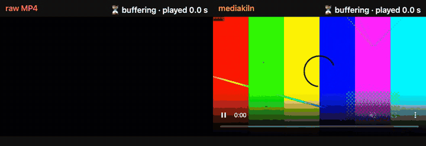

# mediakiln

**Bake the media in a static site so it's ready to stream.**

Run it after your build, and every `<video>` and `` comes out optimized: faststart MP4s,
adaptive HLS streams, posters, AVIF/WebP images, responsive `srcset`, lazy loading. The output
is plain static files that any host or CDN can serve. No service, no account, no per-minute
pricing.

```bash
npx github:drk1rd/mediakiln ./dist
```

```
mediakiln v1.0.1 — ./dist
  videos   2 processed (1 HLS, 1 MP4-only), 0 cached     62.3 MB → 41.0 MB
  images   4 processed, 0 cached     12.0 MB → 20.4 KB
  pages    1 rewritten
  time   11.6s
```



<sub>The same 30 s, 16 Mbps 1080p video over a 6 Mbps link, ten seconds after pressing play.
Left: the original MP4. Right: after mediakiln. From the
[benchmarks](docs/BENCHMARKS.md).</sub>

## What it does

**Video** (`<video src>` and `<video><source src>`)

- Faststart MP4 (`moov` before `mdat`) so playback starts before the download finishes:
  remuxed losslessly when the source is already web-ready H.264/AAC, re-encoded otherwise
  (`.mp4 .mov .m4v .webm .mkv` in, H.264 MP4 out).
- Multi-rendition HLS (360p/720p/1080p by default) for videos over 10 s or 5 MB, played natively
  on Safari/iOS and via a self-hosted, lazily loaded hls.js elsewhere, with the MP4 as fallback.
- A WebP poster frame, intrinsic `width`/`height` (no layout shift), `playsinline` for autoplay,
  and `preload="none"` until the video nears the viewport.
- Rotation-aware: phone videos keep their orientation and their "1080p".

**Images** (``)

- AVIF, WebP and a JPEG/PNG fallback at responsive widths, wrapped in `<picture>` with
  `srcset`/`sizes`.
- `width`/`height`, `loading="lazy"` (except the first image, the likely LCP) and
  `decoding="async"`.
- EXIF orientation applied, metadata stripped, never bigger than the original.

**Everything**

- Content-hash cache: each asset is processed once, across builds, locally and in CI.
- Idempotent: running it twice gives byte-identical output.
- Leaves everything else alone: markup is edited in place, not re-serialized, so your
  formatting, comments and attribute quoting survive.
- Only local files: external URLs, `data:` and `blob:` are ignored.

## Quick start

Requires Node.js 20+ and ffmpeg (with libx264) on your `PATH`.

```bash
# one-off
npx github:drk1rd/mediakiln ./dist

# pinned
npx github:drk1rd/mediakiln#v1.0.1 ./dist

# as a dev dependency (also gives you the framework plugins)
npm i -D github:drk1rd/mediakiln#v1
```

mediakiln is distributed from GitHub only. It isn't published to the npm registry.
Installing from GitHub builds the package on install via its `prepare` script.

```
mediakiln <dir> [options]

  -c, --config <file>    Config file (default: mediakiln.config.{js,mjs,json} in cwd)
  --base <path>          Public base path the site is served from (default: "/")
  --cache-dir <dir>      Cache directory (default: .mediakiln-cache)
  --no-cache             Disable cache
  --no-video             Skip video processing
  --no-images            Skip image processing
  --no-hls               Never generate HLS (faststart MP4 only)
  --concurrency <n>      Parallel image jobs (default: CPU count)
  --dry-run              Report what would change, write nothing
  --verbose              Detailed logs (ffmpeg commands, timings)
  --json                 Machine-readable summary to stdout
```

Exit codes: `0` success, `1` fatal error (bad directory, no ffmpeg when videos exist), `2`
finished but some assets failed (those elements are left untouched).

Add `.mediakiln-cache/` to your `.gitignore`.

## GitHub Action

```yaml
- run: npm run build
- uses: drk1rd/mediakiln@v1
  with:
    dir: ./dist
    # args: --base /my-repo/   # for project pages served from a sub-path
-  # deploy step (Pages, Netlify, Cloudflare, …)
```

The action installs ffmpeg if the runner lacks it, restores and saves the cache with
`actions/cache`, writes a job summary, and exposes the JSON summary as `outputs.summary`.
Inputs: `dir` (required), `args`, `cache` (default `"true"`), `node-version` (default `22`).

This repository deploys [`examples/plain-html`](examples/plain-html) to GitHub Pages with its
own action ([live demo](https://drk1rd.github.io/mediakiln/)). See
[`.github/workflows/pages.yml`](.github/workflows/pages.yml).

## Docker

```bash
docker run --rm -v "$PWD/dist:/site" ghcr.io/drk1rd/mediakiln /site

# with a persistent cache
docker run --rm -v "$PWD/dist:/site" -v "$PWD/.mediakiln-cache:/work/.mediakiln-cache" \
  ghcr.io/drk1rd/mediakiln /site
```

## Framework plugins

All plugins take the same options as the config file and run after a production build.

**Vite**

```js
// vite.config.js
import mediakiln from "mediakiln/vite";

export default {
  plugins: [mediakiln()],
};
```

Runs in `closeBundle` on `build.outDir`, with `base` taken from Vite's `base`.

**Astro**

```js
// astro.config.mjs
import { defineConfig } from "astro/config";
import mediakiln from "mediakiln/astro";

export default defineConfig({
  integrations: [mediakiln()],
});
```

Runs on `astro:build:done`, with `base` taken from the Astro config. See
[`examples/astro`](examples/astro).

**Eleventy**

```js
// eleventy.config.js
import mediakiln from "mediakiln/eleventy";

export default function (eleventyConfig) {
  eleventyConfig.addPlugin(mediakiln, { video: { hls: { minDurationSec: 20 } } });
}
```

Runs on `eleventy.after`. It is skipped during `--serve`/`--watch` unless you pass
`enabled: true`.

**Programmatic**

```js
import { optimize, formatSummary } from "mediakiln";

const summary = await optimize({ dir: "dist", base: "/" });
console.log(formatSummary(summary));
```

## Configuration

`mediakiln.config.js` (or `.mjs`/`.json`) in the working directory. Every field is optional;
these are the defaults:

```js
/** @type {import('mediakiln').Config} */
export default {
  base: "/",
  outDirName: "_mediakiln", // generated assets go to <dir>/_mediakiln/<hash>/
  include: ["**/*.html"],
  exclude: [],
  keepOriginals: true, // false deletes source media after a successful run (careful with CSS refs)
  cache: true,
  cacheDir: ".mediakiln-cache",
  concurrency: os.availableParallelism(), // parallel image jobs; videos encode one at a time

  video: {
    enabled: true,
    hls: {
      enabled: true,
      minDurationSec: 10, // HLS when duration ≥ this…
      minSizeMB: 5, //     …or file size ≥ this
      segmentSec: 4,
      renditions: [
        // "height" is the short side; renditions larger than the source are skipped
        { height: 360, videoKbps: 800, audioKbps: 96 },
        { height: 720, videoKbps: 2800, audioKbps: 128 },
        { height: 1080, videoKbps: 5000, audioKbps: 128 },
      ],
    },
    mp4: {
      reencode: "auto", // "auto" | "always" | "never" (never = remux only)
      crf: 23,
      preset: "medium",
      maxHeight: 1080,
    },
    poster: { atSec: 1, format: "webp", quality: 80, keepJpeg: false },
    preload: "metadata", // for eager (non-lazy) videos
    lazy: true,
  },

  images: {
    enabled: true,
    formats: ["avif", "webp"], // plus JPEG/PNG fallback
    widths: [480, 768, 1080, 1600, 2400],
    quality: { avif: 50, webp: 75, jpeg: 78, png: 80 },
    sizes: "100vw", // default sizes attribute
    lazy: true,
    skip: ["**/*.svg", "**/*.gif"],
  },
};
```

Unknown keys produce a warning; invalid values fail with a clear message. Wrap your config in
`defineConfig` from `mediakiln` for editor completion.

### Per-element attributes

| Attribute           | Effect                                  |
| ------------------- | --------------------------------------- |
| `data-mk-skip`      | Leave this element completely untouched |
| `data-mk-eager`     | Don't lazy-load (use on hero/LCP media) |
| `data-mk-no-hls`    | MP4 only for this video                 |
| `data-mk-sizes="…"` | Override `sizes` for this image         |

`data-mk-eager`, `data-mk-no-hls` and `data-mk-sizes` are removed from the output.
`data-mk-hls` and `data-mk-lazy` are added for the runtime.

## How it works

```
your build → dist/ (raw media) → mediakiln → dist/ (optimized) → any host / CDN
                                    │
                         ffmpeg + Sharp, at build time
```

Input:

```html
<video src="/media/demo.mp4" controls></video> 
```

Output:

```html
<video
  controls
  preload="none"
  width="1920"
  height="1080"
  poster="/_mediakiln/a1b2c3d4e5f6/poster.webp"
  data-mk-hls="/_mediakiln/a1b2c3d4e5f6/hls/master.m3u8"
  data-mk-lazy
>
  <source src="/_mediakiln/a1b2c3d4e5f6/video.mp4" type="video/mp4" />
</video>

<picture>
  <source type="image/avif" srcset="/_mediakiln/9f8e…/img-480.avif 480w, …" sizes="100vw" />
  <source type="image/webp" srcset="/_mediakiln/9f8e…/img-480.webp 480w, …" sizes="100vw" />
  
</picture>

<script type="module" src="/_mediakiln/runtime/loader.js"></script>
```

All the heavy work happens at build time. In the browser, pages with videos get a ~1 KB
(gzipped) module that:

- switches lazy videos to `preload="metadata"` when they come within 200px of the viewport,
- attaches HLS: native on Safari/iOS, otherwise it `import()`s the self-hosted
  `hls.light.min.js` (only on pages that need it, at most once), with the MP4 as fallback on
  errors or when Media Source Extensions are missing,
- doesn't auto-play when the visitor prefers reduced motion.

Without JavaScript, the MP4 `<source>` still plays.

Generated files live in `<dir>/_mediakiln/<hash>/` (content-addressed, safe to cache forever)
plus `_mediakiln/runtime/` and `_mediakiln/manifest.json`, which lists every source, its
outputs and the bytes saved.

## Hosting notes

`.m3u8` must be served as `application/vnd.apple.mpegurl` and `.ts` as `video/mp2t`. GitHub
Pages, Netlify, Vercel and Cloudflare Pages already do. Everything under `/_mediakiln/` is
content-hashed, so it can be cached with `immutable`.

nginx:

```nginx
types {
  application/vnd.apple.mpegurl m3u8;
  video/mp2t ts;
}
location /_mediakiln/ {
  add_header Cache-Control "public, max-age=31536000, immutable";
}
```

Apache (`.htaccess`):

```apache
AddType application/vnd.apple.mpegurl .m3u8
AddType video/mp2t .ts
<IfModule mod_headers.c>
  <If "%{REQUEST_URI} =~ m#^/_mediakiln/#">
    Header set Cache-Control "public, max-age=31536000, immutable"
  </If>
</IfModule>
```

## Benchmarks

See [docs/BENCHMARKS.md](docs/BENCHMARKS.md) for methodology and full numbers, and
`npx tsx scripts/bench.mts` to reproduce them.

On a test page with a background loop, a 30 s 1080p video, three 12 MP photos and a
screenshot (synthetic media, so treat image savings as an upper bound):

|                                                              | Raw          | mediakiln          |
| ------------------------------------------------------------ | ------------ | ------------------ |
| Lighthouse performance (mobile)                              | 69           | **100**            |
| Largest Contentful Paint                                     | 62.5 s       | **1.7 s**          |
| Cumulative Layout Shift                                      | 0.145        | **0**              |
| Page weight                                                  | 18.0 MB      | 9.6 MB             |
| Video played in the first 10 s at 6 Mbps (Chromium / WebKit) | 3.1 s / 0 s  | **8.4 s / 9.1 s**  |
| Time to first frame at 20 Mbps (Chromium / WebKit)           | 330 / 424 ms | **272 / 267 ms**   |
| mediakiln run time: first run → re-run with warm cache       |              | 11.6 s → **59 ms** |

The trade-off: if a visitor's fast connection has already preloaded the raw file, its first
frame comes a few hundred milliseconds sooner than lazy HLS. The benchmarks page has the
details and the `data-mk-eager` / `data-mk-no-hls` escape hatches.

## FAQ

**Why not Mux, Cloudinary or Cloudflare Stream?** They're great if you want a managed
service. mediakiln is for when you'd rather keep video as static files next to the rest of
your site: no account, no per-minute billing, no vendor URLs in your markup, and it works
offline and in CI.

**Does it run in the browser?** No. All encoding happens at build time. The only thing that
ships is the ~1 KB loader (plus hls.js on pages with HLS, in browsers without native HLS).

**CI is slow?** The first run encodes everything; after that the content-hash cache makes
unchanged media free. The GitHub Action caches `.mediakiln-cache` for you. Locally, keep the
folder around.

**Can I keep my original files?** Yes, by default (`keepOriginals: true`). The rewritten
HTML just stops pointing at them.

**What about `` already inside `<picture>`, CSS backgrounds or GIFs?** Not in v1; such
elements are left alone. See the roadmap in the [changelog](CHANGELOG.md).

**Licensing of ffmpeg and H.264?** mediakiln doesn't bundle ffmpeg. ffmpeg builds with
libx264 are GPL-licensed and H.264 is patent-encumbered in some jurisdictions; you're
responsible for your own use. hls.js (Apache-2.0) is copied into your output along with its
license notice.

## Development

```bash
npm install
npm run build
npm test            # unit + integration (generates media with ffmpeg)
npm run test:e2e    # Playwright (npx playwright install chromium webkit)
npm run lint && npm run typecheck
```

Design notes and every deviation from the original spec are in
[docs/DECISIONS.md](docs/DECISIONS.md); releases are described in
[docs/RELEASING.md](docs/RELEASING.md).

## License

[MIT](LICENSE)
